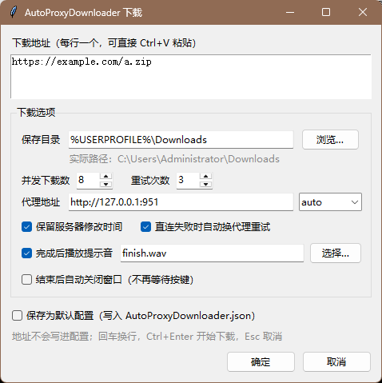

# AutoProxyDownloader

<p align="center"></p>

[English](README.md) | **简体中文**

一个 [aria2](https://aria2.github.io/) 的小型封装：**按每条 URL 判断要不要走 HTTP 代理**（依据 [`gfwlist`](https://github.com/gfwlist/gfwlist)），并把服务器的 `Last-Modified` **时间戳保留到本地文件**上。HLS 流（`.m3u8` / `.m3u`）则交给 **ffmpeg** 合并，直落成一个能播的 `.mp4`。

## 为什么写它

多数下载工具对代理是全局一刀切：要么全部走隧道（访问国内站点又慢又浪费），要么全部直连（被墙的全部失败）。而 aria2 的 `--all-proxy` 是**进程级**开关，要做到"这条走代理、那条直连"就只能一个文件一个 aria2c 进程——本工具就是这么做的，由 gfwlist 负责回答"这条该不该走代理"。

时间戳那一半是给镜像/同步用的：习惯 `curl -R`、`wget --timestamping` 的人，会希望本地文件保留源站 mtime，后续比较才有意义。

## 特性

- **逐 URL 代理决策。** 支持 gfwlist 的 `||域名`、`|前缀`、`后缀|`、`/正则/`、通配、`^` 分隔符、`@@` 例外，第一条命中即决定；命中则传 `--all-proxy=<代理>`，未命中则显式置空代理，避免被环境或别处的配置带偏。
- **保留服务器时间戳。** 先靠 aria2 的 `--remote-time`；下完再用同一出网方式发 `HEAD`（被拒时退化为 `Range: bytes=0-0` 的 GET）复核，差 2 秒以上就用 `os.utime` 修正。服务器没给 `Last-Modified`（动态页面、部分 CDN）时会明确说明，不假装成功。
- **gfwlist 缓存与自动更新。** 首次使用或缓存过期时经代理拉取，原样保存（仍是 base64），旧文件留 `gfwlist.txt.bak`；拉取失败则继续用缓存。
- **未收录但被墙的域名。** 网络类错误会自动换另一种出网方式重试一轮，成功的那次结论按域名记下来，下次直接从能通的方式起步。
- **双引擎。** 普通文件走 aria2c；路径以 `.m3u8` / `.m3u` 结尾的地址走 ffmpeg（`ffmpeg -i <url> -c copy <名字>.mp4`），一个 HLS 流直接落成按播放列表命名的 `.mp4`。是否加代理仍由 gfwlist 判断，只在判定需要代理时才补 `-http_proxy`。
- **批量、续传、跳过。** 线程池调度多个 aria2c 进程，`--continue` 续传，已完整的文件直接跳过，另有 `--dry-run` 与 `--json` 便于脚本化。
- **控制台反馈。** 每个任务开头就报出出网方式（`直连下载：<url>` 或 `代理下载（<代理>）：<url>`），交互式控制台里还有一行原地刷新的进度（字节、百分比、速度、ETA）；输出被重定向时则按 10% 一档打印。
- **双语界面。** 文案跟随 Windows 界面语言（中文系统用中文，其余用英文），可用 `--lang auto|zh|en` 或 `APD_LANG=zh|en` 强制指定。
- **可选图形启动器。** `AutoProxyDownloader_gui.py` 弹出地址输入框，随后在同一个控制台窗口里下载，结束时按任意键才关窗（附 Windows 快捷方式）。

## 环境要求

| | |
| --- | --- |
| Python | 3.10+（用到 `X \| None` 类型标注），Windows 上实测 3.13/3.14 |
| aria2 | `aria2c` 1.16+（需要 `--remote-time`），实测 1.37.0 Windows 版 |
| 系统 | 快捷方式、按任意键暂停这些是 Windows 专用；下载核心本身是跨平台的 |

## 安装

```powershell
git clone <本仓库> AutoProxyDownloader
cd AutoProxyDownloader
```

1. 把 `aria2c.exe` 放到脚本同目录（发布页：<https://github.com/aria2/aria2/releases>）。它**不在**仓库里，见 `.gitignore`。
2. `AutoProxyDownloader.json` 已带可用默认值，无需再做别的。

## 快速开始

```powershell
# 单个地址，落到 %USERPROFILE%\Downloads
python -X utf8 AutoProxyDownloader.py https://example.com/a.zip

# 批量，4 个并发
python -X utf8 AutoProxyDownloader.py --input urls.txt --jobs 4

# 只看它打算怎么走，不下载
python -X utf8 AutoProxyDownloader.py https://www.google.com/ --explain

# 强制更新规则缓存后退出
python -X utf8 AutoProxyDownloader.py --refresh-gfwlist

# 离线自检规则引擎
python -X utf8 AutoProxyDownloader.py --selftest
```

Windows 上建议带 `-X utf8`，避免控制台编码问题。

双击 `AutoProxyDownloader.lnk` 走图形流程：输入或粘贴地址（`Ctrl+Enter` 确认、`Esc` 取消），随后下载在控制台里进行，结束时按任意键关闭窗口。不想留这一步可设环境变量 `APD_NO_PAUSE=1`（改名前的 `ARIA2DL_NO_PAUSE` 同样有效）。



弹框里还带了几个每次都可能要改的选项：

| 界面上的项 | 实际等价于 | “保存为默认配置”是否写入 |
| --- | --- | --- |
| 保存目录 | `-d <目录>` | 写入 |
| 并发下载数 | `--jobs N` | 写入 |
| 重试次数 | `--retry N` | 写入 |
| 代理地址 / 代理模式 | `--proxy`、`--proxy-mode` | 写入 |
| 保留服务器修改时间 | `--mtime` / `--no-mtime` | 写入 |
| 直连失败时自动换代理重试 | `--fallback` / `--no-fallback` | 写入 |

“保存为默认配置”默认不勾：勾上再点确定，上面这些选项（含保存目录）会写回 `AutoProxyDownloader.json`（文件里其它键原样保留）；不勾则只作为本次运行的命令行参数传给主程序。没改过的项不会转成参数，所以命令行里已有的同名参数不会被悄悄覆盖。

地址本身从不入库：它只存在于进程内，配置文件记录的是“怎么下”，不是“下过什么”。

## 控制台输出

每个任务开头先报出出网方式，哪个慢、为什么慢一眼能看出来：

```
[1/2] 直连下载：https://example.com/a.zip
[2/2] 代理下载（http://127.0.0.1:951）：https://www.google.com/robots.txt
```

交互式控制台里，下载过程中这一行会原地刷新：

```
[2] robots.txt  12.3KiB/45.1KiB 27% 8.1KiB/s ETA 4s
```

`--jobs 3` 时多个任务共用这一行（用 ` | ` 分隔）。输出被重定向（写日志、走管道）时改为按 10% 一档打印：

```
  进度 a.zip：26%（2.1MiB/8.0MiB 1.0MiB/s）
```

`-q` 把这些全关掉；`--json` 时不会混入 10% 那类行，方便脚本解析。

## 界面语言

文案随 Windows 界面语言走（中文系统显示中文，否则英文）。想固定一种：

```powershell
python -X utf8 AutoProxyDownloader.py --lang zh https://example.com/a.zip
python -X utf8 AutoProxyDownloader.py --lang en https://example.com/a.zip
$env:APD_LANG = "zh"        # 或 "en"，图形弹框也会跟着变
```

优先级：`APD_LANG` > `--lang` > 系统界面语言（非 Windows 平台退回 `locale` 设置）。

## 代理是怎么判断的

对每条 URL，按顺序：

1. `--proxy-mode never` → 直连，`always` → 全走代理；
2. 非 HTTP(S) 协议 → 直连；
3. 回环、私有网段 → 直连；
4. 配置里的 `always_proxy` / `always_direct` 名单；
5. gfwlist：第一条命中的规则决定结果——`@@` 规则 → 直连，普通规则 → 走代理，一条没命中 → 直连。

`--explain` 会打印判断结果和命中的规则：

```
https://www.google.com/webhp
  出网：代理 http://127.0.0.1:951
  理由：gfwlist 命中：||google.com
```

## 时间戳是怎么保的

1. aria2 以 `--remote-time=true`（`-R`）运行，自己把源站 `Last-Modified` 写到文件上；
2. 下载完成后用同一出网方式（该走代理就走代理）发一次 `HEAD`（HEAD 被拒则用 `Range: bytes=0-0` 的 GET）；差 2 秒以上用 `os.utime` 修正。

只能改 mtime/atime——Windows 的创建时间（birth time）改不了，BitTorrent 类下载也没有服务器时间戳这一说。

## HLS 流：ffmpeg 引擎

aria2 拿 `.m3u8` 只会把播放列表文本存下来，所以路径以 `.m3u8`（或 `.m3u`）结尾的地址改用 ffmpeg：它自己按播放列表取分片，只换封装、不重新编码：

```
ffmpeg -i <url> -c copy <名字>.mp4
```

输出沿用播放列表的名字：`.../hls/index.m3u8` 落成 `index.mp4`（指定 `-o` 时仍以 `-o` 为准）。

- **代理仍由 gfwlist 判。** HLS 地址走和别的 URL 一样的逐条决策（`--proxy-mode always/never` 与 `always_proxy` / `always_direct` 照样优先），只有在判定“走代理”时才补 `-http_proxy <代理>`；未收录的国内 CDN 直连，被墙的才过隧道。首轮失败照样切换到另一种出网方式重试。
- **不保留时间戳。** 一个流是一份播放列表加几十个分片，没有单一的 `Last-Modified` 可套，报告里会写“已跳过”，不假装成功。
- **怎么找 ffmpeg。** 配置项 `ffmpeg` / `--ffmpeg` → 程序目录里的 `ffmpeg.exe` → `PATH`。都没找到时，运行时会提示去哪下（<https://www.gyan.dev/ffmpeg/builds/>，取 `ffmpeg-release-essentials.7z` 那个包），并把 HLS 任务标为失败，同一批次里的 aria2 任务照常下载。
- **进度**取自 ffmpeg 的 `-progress pipe:1`：已写字节数加 `speed=` 倍数。HLS 没有总大小，所以不显示百分比。

## 重试与域名学习

第一轮出网方式遇到**网络类**错误（超时、连接重置、DNS 失败、分片未完成、响应头异常）时，会自动换另一种方式重试一轮。`404`、`403`、认证失败、磁盘满这类换方式也救不回来的，直接失败，不浪费第二轮。

换方式后成功的结论按域名写进 `hosts-learned.json`（`"mode": "proxy"` 或 `"direct"`），后续在 gfwlist 没有意见时直接采用。只写成功结论，一次抖动不会把域名钉死。

`--first-tries`（默认 2）限定第一轮最多试几次就换方式，所以一个未收录但被墙的域名大约 30~40 秒就会切到代理，而不是等几分钟。

## 配置文件

`AutoProxyDownloader.json` 与脚本同目录，并**随仓库提交**（里面没有秘密，只有本机代理端口和 `%USERPROFILE%` 这类相对写法）。配置支持环境变量与 `~` 展开，换机器可直接用。优先级：内置默认 < `AutoProxyDownloader.json` < 命令行参数。

| 键 | 默认 | 含义 |
| --- | --- | --- |
| `aria2` | `aria2c.exe` | aria2c 路径；留空则先找脚本目录、再找 `PATH` |
| `ffmpeg` | `ffmpeg.exe` | ffmpeg 路径，只有 HLS 用得到；留空则先找脚本目录、再找 `PATH` |
| `dir` | `%USERPROFILE%\Downloads` | 输出目录 |
| `proxy` | `http://127.0.0.1:951` | 命中规则时使用的 HTTP 代理 |
| `proxy_mode` | `auto` | `auto` / `always` / `never` |
| `always_proxy` / `always_direct` | `[]` | 覆盖 gfwlist 结论的主机名单 |
| `gfwlist_enabled` | `true` | 设为 `false` 则完全不看规则库 |
| `gfwlist` | `gfwlist.txt` | 缓存文件，相对路径按脚本目录解析 |
| `gfwlist_url` | gfwlist 主分支地址 | 上游来源 |
| `gfwlist_max_age` | `24` | 缓存多少小时后算过期 |
| `refresh_gfwlist` | `false` | 每次运行都强制刷新 |
| `jobs` | `3` | 并发下载数（每个文件一个 aria2c 进程） |
| `split` / `connections` / `min_split_size` | `5` / `5` / `1M` | aria2 分片与连接 |
| `mtime` | `true` | 是否保留服务器时间戳 |
| `overwrite` | `false` | 覆盖已存在文件（默认跳过） |
| `fallback` | `true` | 网络类失败后是否换方式重试一次 |
| `retry` / `first_tries` | `5` / `2` | 后续轮次 / 首轮的最大尝试次数 |
| `learn` / `learn_path` | `true` / `hosts-learned.json` | 域名学习与记录文件 |
| `timeout` / `connect_timeout` | `60` / `20` | 秒 |
| `file_allocation` | `none` | aria2 空间预分配方式 |
| `user_agent`、`referer`、`headers`、`extra_aria2_args` | 见文件 | 请求头与 aria2 参数透传 |

## 命令行参数

完整列表见 `python AutoProxyDownloader.py --help`，常用项如下：

| 参数 | 说明 |
| --- | --- |
| `-d, --dir` | 输出目录（覆盖配置） |
| `-o, --out` | 指定文件名，仅单 URL 时可用 |
| `--proxy`、`--proxy-mode` | 代理地址；`auto` / `always` / `never` |
| `--gfwlist`、`--gfwlist-url`、`--gfwlist-max-age` | 缓存文件、来源、有效期 |
| `--refresh-gfwlist`、`--no-gfwlist` | 强制刷新 / 不看规则库 |
| `--jobs`、`--split`、`--connections` | 并发与分片 |
| `--no-mtime` / `--mtime`、`--overwrite`、`--no-fallback` / `--fallback` | 时间戳 / 已存在文件 / 重试行为 |
| `--first-tries`、`--no-learn`、`--learn-path`、`--forget-learned` | 换方式阈值与域名学习 |
| `--header`、`--referer`、`--extra-arg` | 附加请求头、Referer、原样透传给 aria2c |
| `--aria2`、`--ffmpeg` | 两个引擎的可执行文件路径 |
| `--lang auto\|zh\|en` | 输出语言（默认跟随系统） |
| `--dry-run`、`--explain`、`--json` | 查看决策与输出 |
| `--selftest` | 离线规则引擎自检 |

## 仓库结构

```
AutoProxyDownloader.py             CLI 下载器（单文件，仅标准库）
AutoProxyDownloader_gui.py         图形启动器（弹框输入 → 控制台下载 → 按任意键暂停）
AutoProxyDownloader.json           配置文件（随仓库提交，路径可移植）
AutoProxyDownloader.ico            应用图标（16–256 px，快捷方式使用）
icon.png                           本 README 用的图标图
docs/dialog-zh.png、dialog-en.png  两份 README 用的弹框截图
AutoProxyDownloader.lnk            指向图形启动器的 Windows 快捷方式（被忽略，含本机绝对路径）
.gitignore
README.md                          英文说明
README.zh-CN.md                    本文件
gfwlist.txt                        规则缓存（被忽略，首次经代理自动拉取）
hosts-learned.json                 域名学习记录（被忽略，运行时生成）
aria2c.exe                         aria2 本体（被忽略）
ffmpeg.exe                         ffmpeg 本体，只有 HLS 用（被忽略）
```

在别的机器上重建快捷方式：

```powershell
$ws = New-Object -ComObject WScript.Shell
$lnk = $ws.CreateShortcut("$PWD\AutoProxyDownloader.lnk")
$lnk.TargetPath = (Get-Command python).Source
$lnk.Arguments = '"' + "$PWD\AutoProxyDownloader_gui.py" + '"'
$lnk.WorkingDirectory = "$PWD"
$lnk.IconLocation = "$PWD\AutoProxyDownloader.ico,0"
$lnk.Save()
```

## 排查

| 现象 | 处理 |
| --- | --- |
| 提示代理连不上 | 代理软件没开或端口不对，`--proxy` 改端口 |
| 全部下载超时 | 用 `--explain` 看判断结果，必要时 `--proxy-mode always` |
| 时间戳还是"现在" | 服务器没给 `Last-Modified`，动态内容属正常 |
| HLS 任务报"缺少 ffmpeg" | 把 `ffmpeg.exe` 放到脚本同目录，或用 `--ffmpeg` 指过去：<https://www.gyan.dev/ffmpeg/builds/> |
| 想看 aria2 原始日志 | 加 `-v` |
| 双击后控制台一片空 | 控制台先于弹框打开，进度就打印在这里 |

## 已知边界

- 代理只对初始 URL 判断；直连后 302 跳到墙外域名，靠重试与学习机制兜底。
- 忽略 `Content-Disposition` 文件名，按 URL 路径取名字（需要时用 `-o` 指定）。
- 目录式 URL（`https://host/`）落成 `host.html`，避免多个站点都写成 `index.html`。
- `--jobs` 大于 1 时，同批任务一起开跑，域名学习只在"下次运行"时省事，同批内省不了。
- HLS 只换封装、不重编码：mp4 装不下的编码组合会在封装阶段失败，报告里显示 ffmpeg 的最后一行错误。
- HLS 只按 URL 路径识别：地址里没有 `.m3u8` / `.m3u` 的播放列表会被 aria2 当成普通文件下载（这种只能用 `-o … .mp4` 加手动跑一次 ffmpeg）。
- 图形启动器、按任意键暂停、快捷方式是 Windows 专用；下载核心不限平台。
